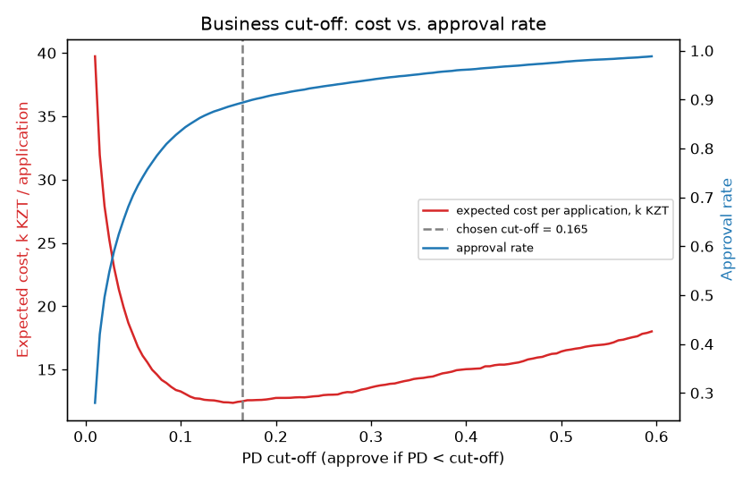
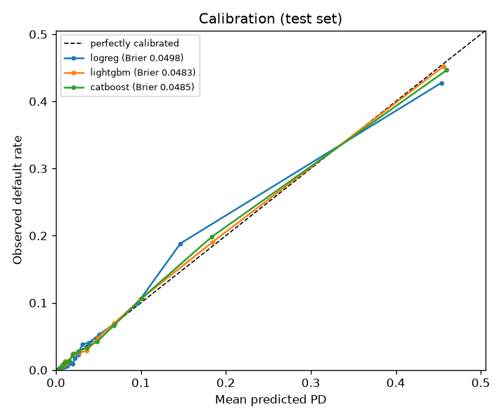
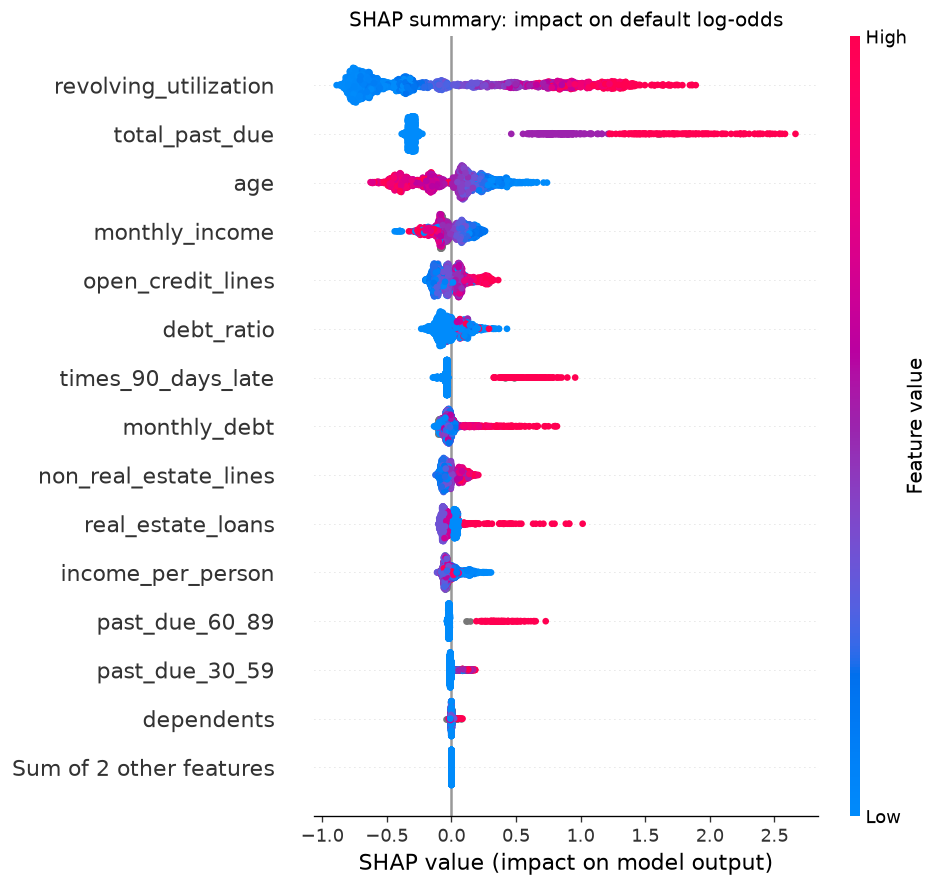
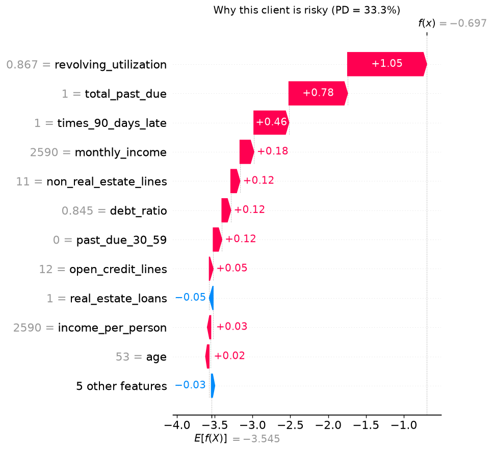
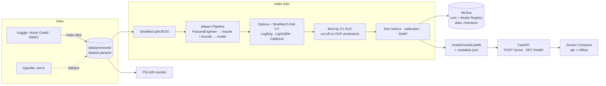

# Credit Scoring — Probability of Default model, from raw data to a REST API

[](https://github.com/alisherizmukhan/credit-scoring/actions/workflows/ci.yml)


End-to-end retail credit scoring: data download → EDA → leakage-safe feature pipeline →
logistic regression / LightGBM / CatBoost with Optuna → calibration, SHAP and a cost-based
cut-off → MLflow model registry → FastAPI service in Docker → PSI drift monitoring.

## The problem and why it matters

A bank receives a loan application and must decide **approve or decline** in seconds.
The model estimates the **probability of default (PD)** — that the borrower will be 90+ days
past due within two years — and turns it into

* a **credit score** on the familiar 300–850 scale (higher = safer),
* a **decision** that minimises expected cost: approving a future defaulter loses the principal
  (`loan × LGD`), rejecting a good client loses interest income (`loan × margin`).

PD is also an input to expected loss (`EL = PD × LGD × EAD`), IFRS 9 provisions and risk-based pricing,
so the model must not only *rank* clients well but also produce **calibrated probabilities**.

## Results

Dataset: *Give Me Some Credit* — 150 000 borrowers, 6.68% defaults
(the pipeline also supports *Home Credit Default Risk* with credit-bureau aggregates, see [Data](#data)).
Stratified 80/20 hold-out; model selection on 5-fold CV inside the training part; the test set is used once.

| Model | CV ROC-AUC | Test ROC-AUC | Test Gini | Test PR-AUC | Test KS | Test Brier |
|---|---|---|---|---|---|---|
| Logistic regression (baseline) | 0.8535 ± 0.0031 | 0.8586 | 0.7173 | 0.3958 | 0.5572 | 0.0498 |
| **LightGBM** (Optuna, 30 trials) — *selected* | **0.8652 ± 0.0036** | 0.8718 | 0.7436 | **0.4153** | 0.5936 | **0.0483** |
| CatBoost (Optuna, 20 trials) | 0.8651 ± 0.0033 | 0.8722 | 0.7443 | 0.4087 | 0.5948 | 0.0485 |

Gini = 2·AUC − 1. LightGBM and CatBoost are statistically tied (difference ≪ CV std);
LightGBM is selected by mean CV AUC, has the best Brier score and is ~6× faster to train.

### Business cut-off (test set, 30 000 applications)

Cost matrix: average loan 500 000 KZT, LGD 0.6, margin 12% → a missed default costs
300 000 KZT, a rejected good client 60 000 KZT (**5× cheaper**).
The cut-off is chosen on **out-of-fold** train predictions, then evaluated on test.

| Policy | PD cut-off | Approval rate | Default rate among approved | Expected cost per 1 000 applications |
|---|---|---|---|---|
| Approve everyone | — | 100.0% | 6.68% | 20.05 M KZT |
| Naive threshold | 0.50 | 97.7% | 5.41% | 16.42 M KZT |
| **Cost-optimal threshold** | **0.165** | **89.4%** | **3.14%** | **12.49 M KZT (−38%)** |

The empirical optimum (0.165) matches the Bayes-optimal threshold for a calibrated model,
`C_FP / (C_FP + C_FN) = 1/6 ≈ 0.167`. Rejecting 10.6% of applicants catches 58% of defaults.

<p align="center">
  
  
</p>

### Explainability (SHAP)

<p align="center">
  
  
</p>

Left: high revolving utilization, past-due events and young age increase risk — consistent with
credit-risk intuition. Right: why one declined applicant (PD 33%) is risky — high card utilization,
a 90-days-late event and low income. These contributions can be turned into adverse-action reason codes.

## Architecture



## Project structure

```
credit-scoring/
├── src/credit_scoring/
│   ├── data.py        # download (Kaggle → OpenML fallback) and preparation
│   ├── features.py    # row-wise features, bureau aggregates, sklearn preprocessing
│   ├── train.py       # split, Optuna, CV, model selection, MLflow, artifacts
│   ├── evaluate.py    # AUC / Gini / PR-AUC / KS / Brier, calibration, cost-based cut-off
│   ├── explain.py     # SHAP summary + single-client explanation
│   ├── predict.py     # PD → score (300–850) → decision; batch scoring CLI
│   ├── drift.py       # Population Stability Index report
│   └── config.py
├── api/               # FastAPI app and Pydantic schemas
├── configs/config.yaml
├── notebooks/01_eda.ipynb
├── reports/           # plots and metrics from the last training run
├── tests/             # pytest: features, leakage, training, API, drift
├── Dockerfile, docker-compose.yml, Makefile, pyproject.toml
└── LEARNING.md        # design decisions explained step by step (in Russian)
```

## Quick start

Requirements: Python 3.11+, `make`, Docker (for the container part).

```bash
git clone https://github.com/alisherizmukhan/credit-scoring.git
cd credit-scoring
python -m venv .venv && source .venv/bin/activate   # Windows: .venv\Scripts\activate
make install        # pip install -e ".[train,dev]"

make data           # download + prepare the dataset → data/processed/
make train          # ~7 min on 16 cores; writes models/, reports/, mlflow.db
make test           # 59 tests, coverage ≥ 70% enforced
make drift          # PSI report → reports/drift_report.md
```

Run the service:

```bash
docker compose up --build -d     # api on :8000, MLflow server on :5000
# ports are configurable: MLFLOW_PORT=5001 API_PORT=8080 docker compose up --build -d
# or without Docker: make api
```

Score an application:

```bash
curl -X POST http://localhost:8000/score \
  -H "Content-Type: application/json" \
  -d '{"revolving_utilization": 0.35, "age": 42, "past_due_30_59": 0, "debt_ratio": 0.28,
       "monthly_income": 6500, "open_credit_lines": 7, "times_90_days_late": 0,
       "real_estate_loans": 1, "past_due_60_89": 0, "dependents": 2}'
```

```json
{"probability_default": 0.0219, "score": 643, "decision": "approve", "threshold": 0.165, "model_version": "1"}
```

A riskier applicant (utilization 0.95, age 27, two 30–59 and one 90+ past-due events) gets
`{"probability_default": 0.608, "score": 399, "decision": "decline"}`.
Invalid input (e.g. `age: 10`, unknown fields) is rejected with HTTP 422. Interactive docs: `http://localhost:8000/docs`.

### MLflow

* Local runs: `make mlflow-ui` → http://localhost:5000 (SQLite backend `mlflow.db`).
* Dockerised server: `MLFLOW_TRACKING_URI=http://localhost:5000 make train` logs runs, artifacts
  and the registered model `credit-scoring-pd` (alias `champion`) into the compose `mlflow` service.

Each training run logs parameters (including the Optuna optimum), CV and test metrics,
plots, the model with its signature and input example, and registers the best pipeline.

## Data

`make data` resolves the source automatically (`dataset: auto` in `configs/config.yaml`):

1. **Home Credit Default Risk** (`application_train.csv` + `bureau.csv`) — if a Kaggle token exists
   (`~/.kaggle/kaggle.json`); bureau history is aggregated per client (count / mean / max / sum,
   active-credit share) and joined with ratio features (credit/income, annuity/income, …);
2. **Give Me Some Credit** from Kaggle;
3. the same dataset from the **OpenML** mirror (id 46929) — no credentials needed.

Data is never committed (`data/` is git-ignored). The results above come from source 3.

## Key design decisions

* **No leakage by construction.** Row-wise features (ratios, anomaly fixes, bureau aggregates)
  use only the client's own data; everything learned from data (imputation medians, winsorizing
  quantiles, scaling, encoders) lives inside one `sklearn.Pipeline` fitted on the training fold.
  Dedicated tests check it.
* **Honest evaluation.** Model selection and the cut-off use CV / out-of-fold predictions only;
  the hold-out set is touched once.
* **Calibrated PD over resampling.** No SMOTE or class weights — imbalance is handled by metrics
  (Gini, PR-AUC, KS) and a cost-based threshold, keeping probabilities usable for pricing and provisions.
* **One artifact for training and serving.** The API loads the same pipeline, so feature logic
  cannot diverge between training and production.
* **Monitoring.** PSI with reference-quantile bins and a missing-value bin; < 0.1 stable,
  0.1–0.25 moderate, > 0.25 significant.

A step-by-step explanation of every decision, the alternatives and typical interview questions
is in [LEARNING.md](LEARNING.md) (Russian).

## What to improve next

* **Out-of-time validation** on data with application dates (GMSC has none).
* Full **Home Credit** relational features (`bureau_balance`, `previous_application`, installments).
* **WoE/IV scorecard** as a regulatory benchmark; monotonic constraints in LightGBM.
* **Reject inference** to reduce selection bias (the model only sees approved applicants).
* **Reason codes** in the API response (top SHAP contributions), three-zone decisions with manual review.
* Production hardening: authentication, request/prediction logging, Prometheus metrics,
  scheduled PSI checks with alerts, champion/challenger rollout from the MLflow registry.
* Spark (PySpark) feature pipelines for bank-scale data.

## License

MIT
